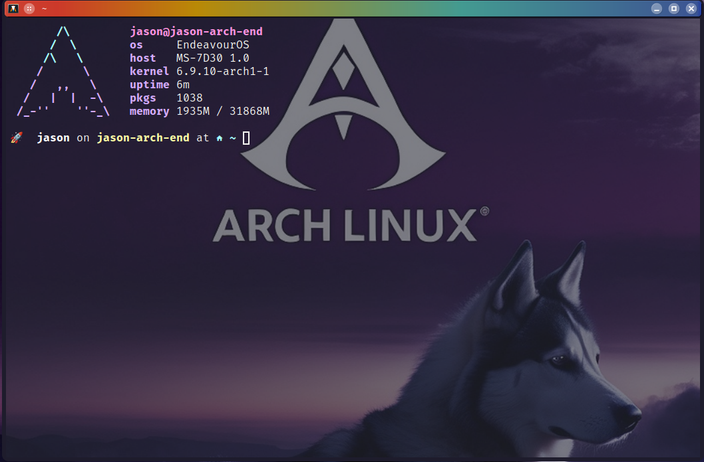

# dotfiles

My terminal and desktop configs: fish + starship in the shell, Hyprland and
Waybar on Linux, AeroSpace on macOS, in Catppuccin Frappé and Dracula.



**On a Mac?** The MacBook setup has its own folder, install guide and
screenshots: [`macos/`](macos/README.md).

## What is in here

| Path | What it is |
| --- | --- |
| `fish/` | fish shell config, plugins (fisher, done) and themes |
| `starship.toml` | Prompt, shared by Linux and macOS |
| `bash/.bashrc` | Minimal bash config |
| `ghostty/` | Ghostty terminal (Linux; the macOS variant is in `macos/`) |
| `alacritty/` | Alacritty terminal with Catppuccin Frappé and Dracula themes |
| `.wezterm.lua` | WezTerm config (older, kept for reference) |
| `hypr/` | Hyprland, based on [ML4W](https://github.com/mylinuxforwork/dotfiles) with Catppuccin Frappé/Mauve customizations |
| `waybar/` | Waybar themes to match |
| `conky.conf` | Conky system monitor |
| `macos/` | AeroSpace, Ghostty, fish and tmux for a MacBook |

## Linux prerequisites

The commands below are for Arch; notes for other distros follow.

FiraCode Nerd Font Mono

```
yay -S ttf-firacode-nerd
```

Starship

```
curl -sS https://starship.rs/install.sh | sh
```

Alacritty and its themes

```
pacman -S alacritty
yay -S alacritty-themes
```

Fish shell

```
pacman -S fish
```

pfetch-rs (requires rustup: https://rustup.rs/)

```
cargo install pfetch
```

eza, zoxide, fzf, bat and ugrep (used by the aliases in `fish/config.fish`)

```
pacman -S eza zoxide fzf bat ugrep
```

atuin (shell history; `config.fish` initialises it)

```
curl --proto '=https' --tlsv1.2 -LsSf https://setup.atuin.sh | sh
```

Then link or copy the configs into `~/.config` (`fish/`, `ghostty/`,
`alacritty/`, `hypr/`, `waybar/`, `starship.toml`).

### Notes for Fedora

```
sudo dnf install fira-code-fonts
sudo dnf install eza zoxide fzf fish
```

Modify `.config/alacritty/alacritty.toml` and change the font to Firacode
(remove Nerd Mono).

### Notes for Debian

```
sudo nala install fonts-firacode fish zoxide fzf ugrep

cargo install --locked bat
cargo install pfetch-rs
cargo install eza
```

## macOS

See [`macos/README.md`](macos/README.md) for the current setup: what to
install, how to link the configs, the key bindings, and a prompt that lets
Claude Code do the installation.

The earlier macOS notes (WezTerm and Alacritty installed through Homebrew)
are superseded by that guide. The WezTerm config from that setup is still
here as `.wezterm.lua`.
