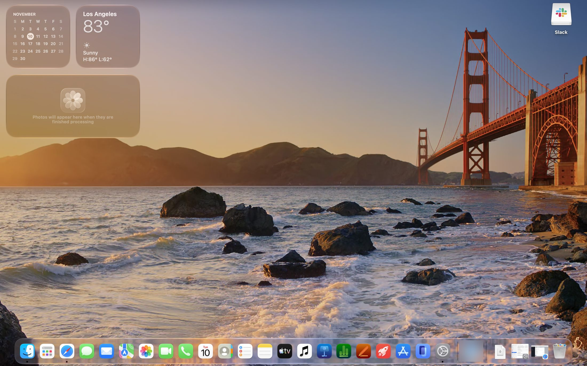
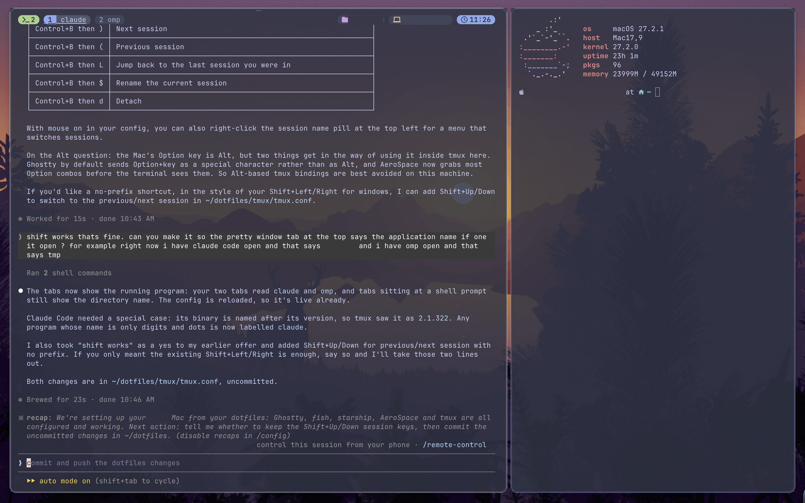

# macOS setup

A Hyprland-style tiling desktop on a MacBook: AeroSpace for tiling and
workspaces, Ghostty + fish + starship in the terminal, tmux inside it, all in
Catppuccin Frappé. The key bindings follow `hypr/conf/keybindings/default.conf`
with Option standing in for Super.

| Before | After |
| --- | --- |
|  |  |

## What is in here

| Path | Linked to | What it is |
| --- | --- | --- |
| `aerospace/aerospace.toml` | `~/.config/aerospace/aerospace.toml` | Tiling, gaps, 10 workspaces, key bindings |
| `ghostty/config.ghostty` | `~/.config/ghostty/config.ghostty` | Terminal: fish, no title bar, Frappé palette |
| `fish/config.fish` | `~/.config/fish/config.fish` | Shell config (macOS variant of `../fish/config.fish`) |
| `tmux/tmux.conf` | `~/.config/tmux/tmux.conf` | Self-contained tmux theme and keys, no plugin manager |
| `Brewfile` | | Everything installed through Homebrew |

These are shared with the Linux setup and linked from the repo root:

| Path | Linked to |
| --- | --- |
| `../starship.toml` | `~/.config/starship.toml` |
| `../fish/fish_plugins` | `~/.config/fish/fish_plugins` |
| `../fish/conf.d/done.fish`, `mocha.fish` | `~/.config/fish/conf.d/` |
| `../fish/functions/fisher.fish` | `~/.config/fish/functions/fisher.fish` |
| `../fish/themes/Dracula Official.theme` | `~/.config/fish/themes/` |

## Install

1. Install [Homebrew](https://brew.sh), then clone this repo to `~/dotfiles`.

2. Install the packages:

   ```sh
   brew bundle --file ~/dotfiles/macos/Brewfile
   ```

3. Install the two tools that do not come from Homebrew here:

   ```sh
   # atuin (shell history)
   curl --proto '=https' --tlsv1.2 -LsSf https://setup.atuin.sh | sh

   # pfetch (the greeting in new terminals); needs Rust from https://rustup.rs
   cargo install pfetch
   ```

4. Link the configs:

   ```sh
   D=~/dotfiles
   mkdir -p ~/.config/{aerospace,ghostty,tmux} ~/.config/fish/{conf.d,functions,themes}

   ln -sfn $D/macos/aerospace/aerospace.toml ~/.config/aerospace/aerospace.toml
   ln -sfn $D/macos/ghostty/config.ghostty   ~/.config/ghostty/config.ghostty
   ln -sfn $D/macos/fish/config.fish         ~/.config/fish/config.fish
   ln -sfn $D/macos/tmux/tmux.conf           ~/.config/tmux/tmux.conf

   ln -sfn $D/starship.toml                  ~/.config/starship.toml
   ln -sfn $D/fish/fish_plugins              ~/.config/fish/fish_plugins
   ln -sfn $D/fish/conf.d/done.fish          ~/.config/fish/conf.d/done.fish
   ln -sfn $D/fish/conf.d/mocha.fish         ~/.config/fish/conf.d/mocha.fish
   ln -sfn $D/fish/functions/fisher.fish     ~/.config/fish/functions/fisher.fish
   ln -sfn "$D/fish/themes/Dracula Official.theme" ~/.config/fish/themes/
   ```

5. Open AeroSpace once and grant it Accessibility access when macOS asks
   (System Settings → Privacy & Security → Accessibility). It starts at login
   after that and launches the window borders itself.

6. Open Ghostty. It starts fish directly from `/opt/homebrew/bin/fish`, so the
   login shell can stay as zsh.

Notes:

- AeroSpace does not watch its config. After editing it, press
  Option+Shift+R (or run `aerospace reload-config`).
- The Ghostty config assumes Apple Silicon Homebrew (`/opt/homebrew`). On an
  Intel Mac change `command` to `/usr/local/bin/fish`.
- `config.fish` sets `EDITOR` to `nvim`; install it (`brew install neovim`) or
  change those two lines.
- Many aliases in `config.fish` are Arch leftovers (`pacman`, `reflector`,
  `expac`) and do nothing useful on macOS.

## Keys

Option is the main modifier.

| Keys | Action |
| --- | --- |
| Option+Enter | New Ghostty window |
| Option+B / Option+E | Browser (Brave) / Finder at home |
| Option+Q / Option+Shift+Q | Close window / quit the app |
| Option+F / Option+M | Fullscreen without gaps / with gaps |
| Option+T | Toggle floating |
| Option+J / Option+K | Flip split direction / swap with next window |
| Option+G | Toggle accordion (stacked) layout |
| Option+Left/Right | Focus window left / right |
| Ctrl+Option+Up/Down | Focus window above / below |
| Ctrl+Option+Left/Right | Move window left / right |
| Ctrl+Option+Shift+Up/Down | Move window up / down |
| Option+Shift+Arrows | Resize by 100 |
| Option+Up/Down | Previous / next workspace, wrapping |
| Option+1…0 | Go to workspace 1–10 |
| Option+Shift+1…0 | Send window to workspace 1–10 |
| Option+Shift+R | Reload the AeroSpace config |
| Ctrl+Option+L | Sleep the display |

tmux keeps the Ctrl+B prefix. Without the prefix: Shift+Left/Right switch
tabs, Shift+Up/Down switch sessions. With it: `|` and `-` split, `<` and `>`
move a tab, `r` reloads the config.

## Suggested Claude prompt

Run [Claude Code](https://claude.com/claude-code) in a terminal on the new Mac
and paste:

```text
Set up this Mac from my dotfiles, following macos/README.md in
https://github.com/jasonwitty/dotfiles exactly.

1. Clone the repo to ~/dotfiles if it is not there, and install Homebrew
   first if it is missing.
2. Run brew bundle on macos/Brewfile, then install atuin and pfetch as the
   README describes.
3. Create the symlinks from the README's link step. If a target already exists
   and is not a symlink into ~/dotfiles, show me the difference and ask before
   replacing it; never delete a file without a backup.
4. Check the result: fish parses its config, `aerospace reload-config`
   succeeds, `ghostty +validate-config` passes, and tmux loads its config.
5. Tell me what I still have to do by hand (granting AeroSpace Accessibility
   access, opening Ghostty) and list anything that failed or that you skipped.

Do not change the files in the repo. If something on this machine needs a
different value (for example an Intel Homebrew path), tell me rather than
editing the config.
```
